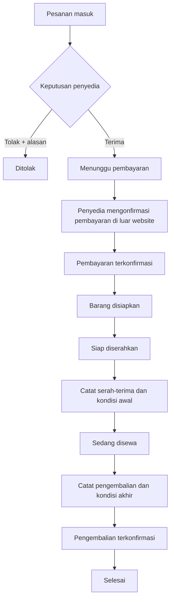
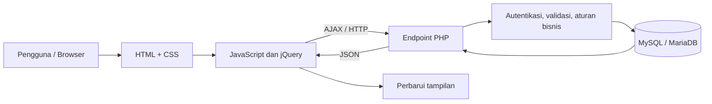

# RuangSewa

### Dashboard penyedia untuk pengelolaan bisnis penyewaan barang

RuangSewa Advanced adalah prototipe website untuk membantu pemilik toko mengelola aktivitas penyewaan barang melalui satu dashboard yang terstruktur. Aplikasi ini dikembangkan sebagai proyek UTS mata kuliah **Pemrograman Web Lanjut** berdasarkan proposal kelompok bertema *Sistem Informasi Penyewaan Barang dengan Reservasi dan Pengelolaan Ketersediaan Stok Berbasis Web*.

Alih-alih hanya menampilkan katalog, RuangSewa berfokus pada pekerjaan operasional penyedia: mengelola inventaris, menindaklanjuti pesanan, mencatat pembayaran yang diterima di luar website, memblokir stok untuk periode tertentu, mencatat kondisi barang saat serah-terima dan pengembalian, serta melihat laporan aktivitas usaha.

> **Ruang lingkup versi ini:** dashboard penyedia. Database menyediakan struktur beberapa peran dari proposal, tetapi halaman login dan endpoint operasional yang diimplementasikan saat ini ditujukan untuk penyedia. Dashboard admin dan website pelanggan belum menjadi bagian dari versi ini.

---

## Daftar isi

- [Gambaran singkat](#gambaran-singkat)
- [Mengapa RuangSewa dibuat](#mengapa-ruangsewa-dibuat)
- [Fitur utama](#fitur-utama)
- [Alur operasional penyewaan](#alur-operasional-penyewaan)
- [Aturan bisnis dan perhitungan stok](#aturan-bisnis-dan-perhitungan-stok)
- [Teknologi yang digunakan](#teknologi-yang-digunakan)
- [Arsitektur aplikasi](#arsitektur-aplikasi)
- [Struktur folder](#struktur-folder)
- [Rancangan database](#rancangan-database)
- [Akun demo](#akun-demo)
- [Skenario pengujian](#skenario-pengujian)
- [Pemecahan masalah](#pemecahan-masalah)
- [Batasan versi dan pengembangan berikutnya](#batasan-versi-dan-pengembangan-berikutnya)

---

## Gambaran singkat

| Informasi | Keterangan |
|---|---|
| Nama aplikasi | RuangSewa Advanced |
| Jenis aplikasi | Dashboard pengelolaan penyewaan barang |
| Pengguna utama | Penyedia/pemilik toko |
| Tujuan utama | Mengatur inventaris, pesanan, ketersediaan, dan proses operasional penyewaan |
| Antarmuka | Responsif untuk desktop, tablet, dan ponsel |
| Pola pemuatan halaman | Navigasi konten dengan jQuery AJAX |
| Backend | PHP dengan PDO |
| Database | MySQL/MariaDB |
| Lingkungan pengembangan | XAMPP pada server lokal |
| Status proyek | Prototipe akademik untuk demonstrasi dan pengujian lokal |

## Mengapa RuangSewa dibuat

Dalam proses penyewaan yang masih dikelola lewat pesan pribadi atau catatan manual, pemilik barang dapat kesulitan mengetahui pesanan mana yang harus diproses, kapan barang sedang digunakan, berapa unit yang masih tersedia, dan apakah pengembalian sudah dikonfirmasi. Pencatatan yang tersebar juga meningkatkan risiko informasi yang tidak konsisten.

RuangSewa menyatukan informasi penting tersebut ke dalam satu panel kerja. Penyedia dapat melihat ringkasan usaha, memperbarui barang, mengecek pesanan, dan mencatat setiap tahap penyewaan tanpa berpindah ke banyak media pencatatan.

Tujuan pengembangan versi ini adalah:

1. Menyediakan dashboard penyedia yang responsif dan mudah dipahami.
2. Menyatukan data barang, pesanan, pembayaran, ketersediaan, serah-terima, dan pengembalian.
3. Membatasi operasi berdasarkan sesi dan toko milik penyedia yang sedang login.
4. Mengurangi kesalahan input melalui validasi di browser dan server.
5. Membantu penyedia menilai aktivitas usaha melalui ringkasan, laporan periode, dan log aktivitas.

## Fitur utama

### 1. Dashboard ringkasan

Halaman ringkasan menjadi titik awal setelah pengguna masuk. Informasi di dalamnya berasal dari data yang dibaca dari database, bukan sekadar angka dekoratif yang ditulis permanen pada HTML. Ringkasan mencakup jumlah barang, jumlah unit, status stok, pesanan yang menunggu keputusan, pendapatan yang terkonfirmasi, tren pendapatan, pesanan terbaru, dan peringatan inventaris.

### 2. Inventaris barang

Halaman **Inventaris Barang** digunakan untuk memantau barang yang terdaftar pada toko penyedia. Fitur inventaris meliputi:

- Melihat daftar barang, kategori, harga sewa, jumlah unit, dan status aktif/nonaktif.
- Mencari barang dan memfilter status inventaris.
- Membuat barang baru dan memperbarui data barang yang sudah ada.
- Mengubah status barang menjadi aktif atau nonaktif tanpa menghapus riwayat transaksinya.
- Mengunggah foto produk dengan pemeriksaan tipe dan ukuran file di server.
- Memvalidasi kategori, harga, jumlah stok, panjang masukan, dan data terkait sebelum perubahan disimpan.

Status nonaktif digunakan untuk menghentikan penawaran barang tanpa menghilangkan catatan pesanan historis. Sistem juga menolak pengurangan stok yang melanggar kebutuhan unit pada jadwal pesanan atau blokir yang masih relevan.

### 3. Pesanan masuk dan keputusan penyedia

Halaman **Pesanan Masuk** menampilkan informasi pesanan yang berkaitan dengan barang milik toko penyedia, termasuk kode pesanan, nama pelanggan, barang, jumlah, periode sewa, total harga, dan status proses.

Dari halaman ini, penyedia dapat:

- Menerima pesanan yang belum diproses.
- Menolak pesanan dengan menyimpan alasan penolakan.
- Mencatat konfirmasi pembayaran setelah pembayaran benar-benar diterima di luar website.
- Menandai barang siap diserahkan.
- Mencatat kondisi barang pada saat diserahkan kepada pelanggan.
- Mencatat kondisi barang ketika dikembalikan.
- Menyelesaikan pesanan setelah tahap pengembalian terkonfirmasi.

Setiap tindakan hanya tersedia pada tahap yang sesuai. Backend memeriksa status pesanan sebelum melakukan perubahan agar pesanan tidak dapat melompati urutan proses secara sembarangan.

### 4. Form tambah dan edit barang

Form inventaris mengelola data inti barang, seperti nama, kategori, deskripsi, harga sewa, total unit yang dimiliki, status publikasi, dan gambar opsional. Isian wajib diperiksa sebelum dikirim dan diperiksa kembali di server sebelum disimpan ke MySQL.

Validasi browser bertujuan membantu pengguna menemukan kesalahan dengan cepat, sedangkan validasi server tetap menjadi pemeriksaan utama karena permintaan HTTP dapat dikirim tanpa melalui antarmuka browser.

### 5. Jadwal dan blokir ketersediaan

Penyedia dapat menutup sebagian unit untuk periode tertentu, misalnya untuk perawatan, penggunaan internal, atau kebutuhan toko lainnya. Form blokir mencatat barang, tanggal mulai, tanggal selesai, jumlah unit, dan alasan.

Sebelum menyimpan blokir, server memeriksa rentang tanggal serta kapasitas barang pada jadwal terkait. Blokir yang telah dimulai tidak dapat dihapus melalui antarmuka, sehingga catatan operasional yang sedang berjalan tidak mudah dihilangkan. Blokir yang belum dimulai dapat dihapus sesuai aturan aplikasi.

### 6. Laporan penyewaan

Halaman **Laporan** menyediakan ringkasan berdasarkan rentang tanggal yang dipilih. Data yang disediakan mencakup jumlah pesanan, pesanan selesai, pesanan ditolak, pendapatan dengan pembayaran terkonfirmasi, tren pendapatan per bulan, distribusi status pesanan, serta barang dengan aktivitas pemesanan tertinggi.

Laporan dapat diekspor ke CSV agar lebih mudah dibuka atau diolah kembali menggunakan aplikasi spreadsheet. Pendapatan dihitung dari catatan pembayaran yang telah ditandai terkonfirmasi, bukan semata-mata dari total harga seluruh pesanan.

### 7. Log aktivitas

Halaman **Log Aktivitas** menyediakan jejak tindakan penting, misalnya login, perubahan inventaris, keputusan pesanan, dan perubahan blokir. Catatan ini membantu pengguna meninjau apa yang telah dilakukan selama operasional.

Log aktivitas versi ini ditujukan untuk kebutuhan audit sederhana dalam prototipe, bukan sebagai sistem audit perusahaan yang lengkap.

### 8. Antarmuka responsif dan interaktif

Layout utama memiliki navigasi dan area konten yang konsisten. Halaman konten dimuat menggunakan jQuery AJAX ke dalam area utama, sehingga pengguna tidak perlu memuat ulang seluruh layout setiap kali berpindah menu. Antarmuka juga menyediakan pencarian/filter, dialog konfirmasi, notifikasi status, indikator proses, dan tampilan alternatif saat data kosong atau terjadi kegagalan permintaan.

---

## Alur operasional penyewaan

Berikut gambaran alur utama yang ditangani dashboard penyedia.



Ringkasan status proses:

| Tahap | Status pesanan | Tindakan penyedia |
|---|---|---|
| Pesanan baru | `menunggu_keputusan` | Meninjau detail, menerima atau menolak |
| Pesanan diterima | `menunggu_dibayar` | Menunggu pembayaran di luar website |
| Pembayaran diverifikasi | `pembayaran_terkonfirmasi` | Mengonfirmasi bahwa dana telah diterima |
| Persiapan | `siap_diserahkan` | Menyiapkan barang untuk pelanggan |
| Barang diserahkan | `sedang_dipakai` | Mencatat waktu dan kondisi awal barang |
| Barang dikembalikan | `pengembalian_terkonfirmasi` | Mencatat waktu dan kondisi akhir barang |
| Proses tuntas | `selesai` | Menyelesaikan pesanan dan memasukkannya ke riwayat |
| Pesanan ditolak | `ditolak` | Menyimpan alasan penolakan |

**Catatan pembayaran:** sesuai ruang lingkup proposal, pembayaran dilakukan di luar website. RuangSewa hanya menyimpan metode/catatan dan status konfirmasi yang dimasukkan penyedia. Aplikasi ini tidak mengirim uang dan tidak terhubung ke payment gateway.

## Aturan bisnis dan perhitungan stok

Ketersediaan tidak hanya ditentukan dari kolom `total_stok`. Sebuah unit dapat sedang dipesan, ditahan sementara, atau diblokir penyedia pada periode tertentu. Karena itu, sistem memeriksa irisan periode pemakaian sebelum menerima pesanan, menambah blokir, atau mengurangi stok.

Secara konseptual, untuk satu barang pada tanggal tertentu:

`Unit tersedia = total unit yang dimiliki - unit yang sedang terpakai/ditahan/diblokir pada tanggal tersebut`

Pemeriksaan di backend menghitung pemakaian maksimum pada rentang tanggal yang diperiksa. Ini lebih tepat daripada menjumlahkan semua pesanan yang bersentuhan dengan rentang yang sama, karena dua pesanan pada tanggal yang berbeda mungkin tidak menggunakan unit secara bersamaan.

Aturan penting lainnya:

- Tanggal mulai tidak boleh melewati tanggal selesai.
- Harga sewa harus bernilai valid dan jumlah unit tidak boleh negatif atau nol jika form mensyaratkan unit positif.
- Barang hanya dapat dikelola oleh penyedia yang memiliki barang tersebut.
- Pesanan hanya dapat diproses oleh penyedia yang tokonya terkait dengan barang pada pesanan itu.
- Pesanan ditolak harus disertai alasan penolakan.
- Konfirmasi pembayaran hanya dilakukan setelah pembayaran benar-benar diterima di luar sistem.
- Catatan kondisi awal dan akhir barang wajib diisi pada proses serah-terima/pengembalian.
- Pengurangan total stok dibatasi oleh kebutuhan stok dari jadwal pesanan dan blokir yang relevan.
- Permintaan yang mengubah data menggunakan sesi penyedia dan token CSRF.

---

## Teknologi yang digunakan

| Teknologi | Peran dalam aplikasi |
|---|---|
| HTML5 | Struktur layout dan komponen halaman |
| CSS3 | Styling, sistem warna, layout, responsivitas, dan komponen antarmuka |
| JavaScript | Interaksi browser dan validasi awal masukan |
| jQuery 3.6.1 | AJAX, event handler, dan pemuatan konten parsial |
| PHP 8.x | Autentikasi, aturan bisnis, validasi server, dan endpoint API |
| PDO | Koneksi MySQL dan prepared statements |
| MySQL/MariaDB | Penyimpanan akun, toko, inventaris, pesanan, pembayaran, dan catatan operasional |
| Apache (XAMPP) | Menjalankan halaman dan endpoint PHP di server lokal |

Tidak diperlukan framework PHP tambahan untuk menjalankan versi ini. Aplikasi menggunakan file HTML terpisah untuk halaman dan file PHP sebagai endpoint backend.

## Arsitektur aplikasi

Secara sederhana, permintaan pengguna melewati beberapa lapisan berikut:



- **Frontend** menampilkan data serta menangani interaksi pengguna.
- **AJAX** meminta data atau mengirim tindakan tanpa memuat ulang seluruh kerangka dashboard.
- **Backend PHP** memverifikasi sesi, token keamanan, hak akses toko, status proses, serta validitas masukan.
- **MySQL/MariaDB** menyimpan data dan hubungan antartabel.
- Respons endpoint menggunakan JSON agar dapat diproses oleh JavaScript.

Pemisahan ini membuat struktur project relatif mudah dipelajari: tampilan berada di `pages/`, logika antarmuka di `js/app.js`, dan aturan/data backend berada di `api/`.

## Struktur folder

```text
PWUTS_KODEKELOMPOK_25091397072/
├── index.html                      # Kerangka dashboard dan navigasi AJAX
├── login.html                      # Halaman login penyedia
├── README.md                       # Dokumentasi proyek
├── .gitignore                      # Pengecualian file upload lokal
├── assets/                         # Ikon dan ilustrasi produk contoh
├── css/
│   └── style.css                   # Styling dan layout responsif
├── js/
│   ├── app.js                      # Navigasi, interaksi, dan komunikasi AJAX
│   ├── login.js                    # Interaksi halaman login
│   └── jquery-3.6.1.min.js         # Library jQuery lokal
├── pages/
│   ├── dashboard.html              # Ringkasan
│   ├── kelola-stok.html             # Inventaris barang
│   ├── pesanan.html                 # Pesanan masuk dan tindakan operasional
│   ├── form-tambah-barang.html      # Tambah/edit barang
│   ├── form-blokir.html             # Jadwal dan blokir ketersediaan
│   ├── laporan.html                # Laporan dan ekspor CSV
│   └── aktivitas.html              # Log aktivitas
├── api/
│   ├── db.php                      # Koneksi database, sesi, helper keamanan
│   ├── auth.php                    # Status sesi, login, dan logout
│   ├── dashboard.php               # Ringkasan data dashboard
│   ├── kategori.php                # Data kategori
│   ├── barang.php                  # Inventaris dan unggah foto
│   ├── pesanan.php                 # Transisi status pesanan
│   ├── blokir.php                  # Jadwal blokir ketersediaan
│   ├── laporan.php                 # Statistik laporan
│   └── aktivitas.php               # Riwayat aktivitas
├── database/
│   ├── penyewaan_barang.sql        # Skema + data demo untuk instalasi baru
│   └── upgrade_existing_database.sql # Migrasi dari database versi dasar
└── uploads/
    └── items/                      # Lokasi foto barang yang diunggah
```

## Rancangan database

Database `db_penyewaan_barang` dirancang dengan 12 tabel yang saling berhubungan. Struktur ini mengikuti konsep pada proposal penyewaan barang.

| Tabel | Fungsi |
|---|---|
| `users` | Data akun pengguna dan kolom peran (`pelanggan`, `penyedia`, `admin`) |
| `toko` | Profil toko penyedia dan status verifikasinya |
| `kategori` | Daftar kategori inventaris |
| `barang` | Data barang, harga sewa, total stok, dan status aktif |
| `media_barang` | Lokasi foto atau media yang terkait dengan barang |
| `hold_stok` | Catatan penahanan unit untuk sementara |
| `pesanan` | Data permintaan sewa, periode, jumlah, harga, dan status proses |
| `pembayaran` | Nominal, metode, status, dan waktu konfirmasi pembayaran |
| `serah_terima` | Waktu penyerahan dan catatan kondisi awal barang |
| `pengembalian` | Waktu pengembalian dan catatan kondisi akhir barang |
| `blokir_ketersediaan` | Jadwal unit yang ditutup dari penyewaan |
| `log_aktivitas` | Catatan tindakan pengguna pada sistem |

Primary key, foreign key, indeks, serta beberapa batasan unik membantu menjaga relasi dan mencegah catatan pembayaran, serah-terima, atau pengembalian ganda untuk satu pesanan. Penggunaan transaksi database pada beberapa operasi penting membantu menjaga konsistensi ketika suatu tindakan melibatkan lebih dari satu perubahan data.

### Endpoint PHP utama

| Endpoint | Kegunaan |
|---|---|
| `api/auth.php` | Memeriksa sesi, login, logout, dan menghasilkan token CSRF |
| `api/dashboard.php` | Mengambil statistik dashboard penyedia |
| `api/kategori.php` | Mengambil pilihan kategori barang |
| `api/barang.php` | Membaca, menambah, mengedit, dan mengaktifkan/menonaktifkan barang |
| `api/pesanan.php` | Membaca pesanan dan memproses transisi statusnya |
| `api/blokir.php` | Membaca, membuat, dan menghapus blokir mendatang sesuai aturan |
| `api/laporan.php` | Menyediakan ringkasan dan data laporan berdasarkan periode |
| `api/aktivitas.php` | Membaca log aktivitas penyedia |

Endpoint tidak dimaksudkan untuk diakses sebagai halaman HTML biasa; endpoint mengembalikan respons JSON yang digunakan antarmuka.

---


## Akun demo

Gunakan akun berikut untuk mencoba dashboard penyedia setelah database siap.

| Informasi | Nilai |
|---|---|
| Email | `penyedia@example.test` |
| Kata sandi | `SewaDemo123!` |
| Nama pengguna | Bagus Penyedia |
| Nama toko contoh | RuangSewa Studio |

Kata sandi demo disimpan dalam database sebagai hash dan diverifikasi menggunakan `password_verify()`. Kredensial ini disediakan hanya untuk pengujian lokal. Ganti atau hapus akun demo sebelum aplikasi digunakan di lingkungan selain praktikum.

### Data contoh

Database instalasi baru memuat barang contoh seperti kamera, proyektor, speaker, tenda, dan tripod, ditambah beberapa pesanan dengan status berbeda. Data ini sengaja disediakan supaya halaman dashboard, pesanan, laporan, dan alur operasional dapat dicoba tanpa harus memasukkan seluruh data dari nol.

---

## Skenario pengujian

Lakukan pengujian berikut setelah aplikasi berhasil dijalankan.

### A. Login dan keamanan akses

- Masuk dengan akun demo yang benar.
- Coba alamat email/kata sandi yang salah.
- Coba mengakses endpoint API tanpa login; akses seharusnya ditolak.
- Coba membuka dashboard tanpa sesi aktif; aplikasi seharusnya meminta pengguna untuk masuk kembali.
- Keluar melalui tombol logout dan pastikan sesi sudah tidak aktif.

### B. Inventaris barang

- Tambahkan barang dengan masukan valid, kemudian pastikan barang tampil di daftar inventaris.
- Coba mengirim nama kosong, harga negatif, stok tidak valid, atau kategori yang tidak tersedia.
- Unggah gambar dengan tipe yang diperbolehkan dan ukuran tidak lebih dari 2 MB.
- Coba mengunggah file bertipe tidak diperbolehkan atau file di atas batas ukuran.
- Edit barang dan pastikan perubahan tersimpan setelah data dimuat ulang.
- Nonaktifkan barang dan pastikan statusnya berubah tanpa menghapus data historis.
- Coba mengurangi stok ketika jadwal pesanan atau blokir masih membutuhkan unit yang lebih banyak daripada stok baru; server seharusnya menolak perubahan tersebut.

### C. Pemrosesan pesanan

- Buka pesanan berstatus menunggu keputusan.
- Coba menolak pesanan tanpa alasan; server seharusnya menolak permintaan.
- Terima pesanan, lalu pastikan status berubah menjadi menunggu pembayaran.
- Konfirmasikan pembayaran setelah tahap yang sesuai.
- Tandai pesanan siap diserahkan.
- Masukkan catatan kondisi awal ketika mencatat serah-terima.
- Catat kondisi barang saat kembali, lalu selesaikan pesanan setelah pengembalian dikonfirmasi.
- Periksa bahwa tindakan yang tidak sesuai dengan status pesanan ditolak oleh backend.

### D. Blokir ketersediaan

- Buat blokir pada rentang tanggal yang valid dengan jumlah unit yang tersedia.
- Coba membuat blokir dengan tanggal mulai setelah tanggal selesai.
- Coba meminta jumlah unit melebihi kapasitas yang tersedia pada periode tersebut.
- Periksa bahwa blokir memengaruhi validasi stok untuk jadwal yang beririsan.
- Pastikan blokir yang sudah dimulai tidak dapat dihapus melalui antarmuka.

### E. Laporan dan aktivitas

- Pilih rentang tanggal laporan yang berbeda.
- Bandingkan ringkasan pendapatan dengan catatan pembayaran yang berstatus terkonfirmasi pada periode tersebut.
- Ekspor laporan ke CSV dan buka file hasilnya menggunakan spreadsheet.
- Periksa apakah login dan tindakan operasional yang didukung muncul pada Log Aktivitas.

### F. Responsivitas

- Uji menu dan form pada resolusi desktop.
- Persempit ukuran browser atau gunakan mode perangkat seluler.
- Pastikan tabel, dialog, navigasi, dan form tetap dapat digunakan tanpa konten utama terpotong.

> Pengujian di atas adalah panduan pengujian manual. Keberhasilan setiap skenario perlu diverifikasi saat aplikasi dijalankan di XAMPP; dokumentasi ini tidak mengklaim semua skenario telah diuji end-to-end di setiap komputer.

---

## Pemecahan masalah

| Gejala | Hal yang perlu diperiksa |
|---|---|
| Browser menampilkan `Not Found` | Pastikan folder berada di `htdocs` dan URL menggunakan nama folder yang tepat. |
| PHP ditampilkan sebagai teks atau tidak diproses | Buka melalui `http://localhost/...` dan pastikan Apache aktif. Jangan gunakan `file:///...`. |
| Login selalu gagal | Periksa email, kata sandi, hasil impor database, status verifikasi toko, dan apakah akun penyedia demo ada di tabel `users` serta terkait dengan `toko`. |
| Pesan koneksi database muncul | Pastikan MySQL berjalan dan kredensial pada `api/db.php` sesuai konfigurasi lokal. |
| Halaman konten tidak dimuat | Periksa console browser, status Apache, dan apakah file pada `pages/` serta `js/app.js` tersedia di lokasi yang benar. |
| Data tidak tersimpan | Periksa respons pada tab Network browser, pesan endpoint, validasi form, sesi login, token CSRF, dan struktur tabel. |
| Impor SQL gagal pada indeks unik | Periksa apakah database lama memiliki lebih dari satu catatan pembayaran/serah-terima/pengembalian untuk pesanan yang sama sebelum mengulangi migrasi. |
| Foto tidak muncul | Periksa apakah file berhasil diunggah, izin tulis folder `uploads/items/`, dan alamat media tersimpan di database. |

---

## Batasan versi dan pengembangan berikutnya

RuangSewa Advanced dibuat untuk menjadi prototipe operasional dashboard penyedia dan materi demonstrasi akademik. Beberapa batasan sengaja dicantumkan agar cakupan aplikasinya tidak disalahartikan.

- **Dashboard admin belum tersedia.** Walaupun struktur `users` mengenal peran `admin`, endpoint login saat ini menerima peran penyedia. Fitur verifikasi toko dan halaman pemantauan admin dari proposal belum diimplementasikan dalam modul ini.
- **Website pelanggan belum tersedia.** Pembuatan pesanan pada versi ini diasumsikan berasal dari data pesanan yang telah ada di database; sisi pelanggan yang melakukan pencarian barang dan pengajuan sewa tidak termasuk UI ini.
- **Tidak ada payment gateway.** Konfirmasi pembayaran adalah pencatatan manual oleh penyedia setelah pembayaran di luar website diterima.
- **Belum ada notifikasi email/WhatsApp, reset kata sandi, atau sistem ulasan.** Semua itu dapat menjadi pengembangan berikutnya.
- **Akun demo dan konfigurasi lokal bukan untuk produksi.** Aplikasi memerlukan review keamanan, konfigurasi server, backup, HTTPS, pengaturan rahasia, pemantauan, dan pengujian concurrency sebelum digunakan untuk bisnis nyata.
- **Pengujian integrasi perlu dilakukan di lingkungan pengguna.** Kode dan struktur project telah diperiksa, tetapi backend MySQL perlu diverifikasi di XAMPP karena server database tidak tersedia pada lingkungan penyusunan project.

Pengembangan yang dapat dipertimbangkan berikutnya adalah dashboard admin, halaman pelanggan, kalender ketersediaan visual, pemberitahuan otomatis, laporan lebih lengkap, dan pengujian otomatis.


**RuangSewa Advanced — kelola inventaris dengan rapi, proses pesanan dengan jelas, dan pantau penyewaan dalam satu dashboard.**
